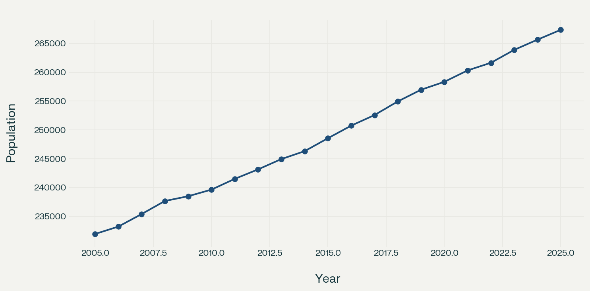
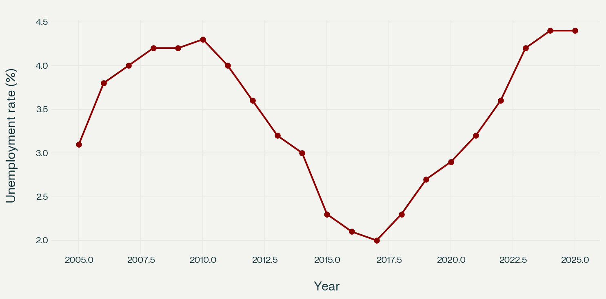
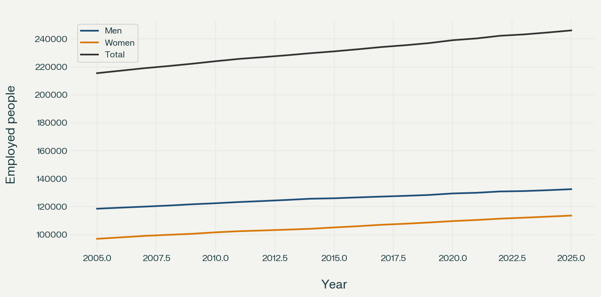
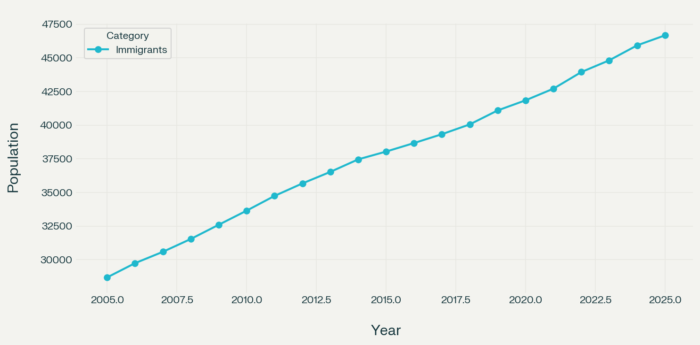
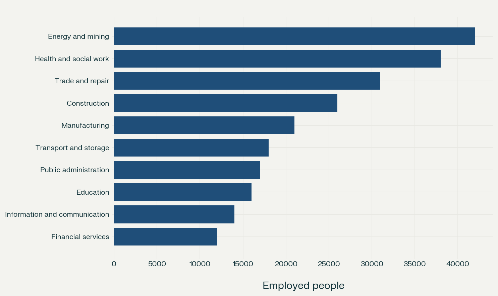

# Employment and Immigration in Rogaland and Stavanger

Beginner-friendly data analysis project using public data from Statistics Norway (SSB).

## Project question
How have population, employment, unemployment, and immigration changed in Rogaland and Stavanger over time?

## Data
The CSV files are **sample data** created for learning and demonstration. To use official data, download tables from [SSB Statbank](https://www.ssb.no/en/statbank/) and replace the CSV files.

## Tools
Python, pandas, matplotlib, SQL and Power BI.

## How to run
```bash
pip install -r requirements.txt
python analysis.py
```

## Charts







## What this project shows
- Data cleaning
- Trend analysis
- Data visualisation
- Basic SQL
- Clear communication of results
